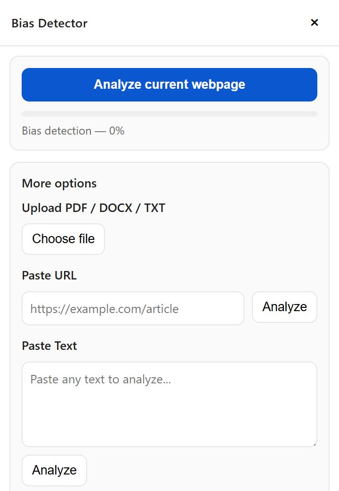
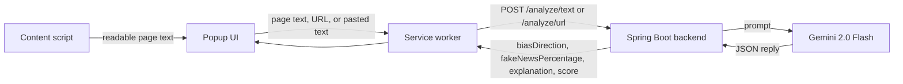

# Bias Detector

A Chrome extension that checks a webpage, a URL, or pasted text for political bias and fake-news likelihood. The extension sends the text to a small Spring Boot backend, which asks Google's Gemini model to analyze it and returns the result to the popup.

Built for **HackRU 2025**.

## What it does

Open the extension on any page and click **Analyze current webpage**, or use **More options** to analyze a pasted URL or pasted text. The popup then shows:

- a **fake-news level** from 0 to 100
- a **bias direction** (left, right, or neutral) with a confidence percentage
- a short **explanation** of the model's reasoning

> The results are an AI model's estimates, not fact-checks. Treat them as a starting point for your own judgment.

<p align="center">
  
</p>

## How it works



1. A **content script** pulls the readable text from the current page (preferring `<article>`, then `<main>`, then the whole body, capped at 100,000 characters).
2. The popup passes that text through the extension's **service worker**, which calls the backend.
3. The **Spring Boot backend** builds a prompt, calls the Gemini API, and parses the model's reply. For a URL, it first downloads the page and extracts its text with Jsoup.
4. The popup displays the fake-news level, the bias label and score, and the explanation.

## Tech stack

- **Backend:** Java 17, Spring Boot 3.5, OkHttp, Jsoup, Lombok
- **AI:** Google Gemini API (`gemini-2.0-flash`)
- **Extension:** JavaScript, Chrome Extension Manifest V3 (popup, content script, service worker)

## Getting started

### Prerequisites

- Java 17 or newer
- Google Chrome
- A Gemini API key from [Google AI Studio](https://aistudio.google.com/app/apikey)

### 1. Run the backend

The API key is read from the `GEMINI_API_KEY` environment variable. It is never stored in the repository.

```bash
cd biasdetector

# macOS / Linux
export GEMINI_API_KEY="your-key-here"
./mvnw spring-boot:run
```

```powershell
# Windows (PowerShell)
cd biasdetector
$env:GEMINI_API_KEY = "your-key-here"
.\mvnw.cmd spring-boot:run
```

The backend starts on <http://localhost:8080>. If `GEMINI_API_KEY` is not set, it refuses to start.

### 2. Load the extension

1. Open `chrome://extensions` and turn on **Developer mode**.
2. Click **Load unpacked** and select the folder `biasdetector/src/main/resources/static`.
3. Pin the extension, open any article, and click the toolbar icon.

The extension talks to `http://localhost:8080` by default. To point it at a different backend, run this in the popup's DevTools console:

```js
chrome.storage.sync.set({ backendBase: 'http://YOUR_HOST:PORT' })
```

### Try the API directly

```bash
curl -X POST http://localhost:8080/analyze/text \
  -H "Content-Type: application/json" \
  -d '{"text": "Paste an article or paragraph here."}'
```

Example response shape:

```json
{
  "biasDirection": "neutral (70%)",
  "fakeNewsPercentage": "10%",
  "explanation": "…",
  "score": 70.0
}
```

| Endpoint | Body | Description |
| --- | --- | --- |
| `POST /analyze/text` | `{"text": "..."}` | Analyze text you provide |
| `POST /analyze/url` | `{"url": "https://..."}` | Download a page, then analyze its text |

## Project structure

```
biasdetector/
├── pom.xml
└── src/main
    ├── java/com/biascheck/biasdetector/
    │   ├── controller/AnalysisController.java   # REST endpoints
    │   └── service/GeminiService.java           # Gemini prompt + response parsing
    └── resources/
        ├── application.properties
        └── static/                              # the Chrome extension
            ├── manifest.json
            ├── popup/                           # popup UI
            ├── content/                         # content script (page text extraction)
            ├── background/service-worker.js     # calls the backend
            └── lib/api.js
```

`Final Bias Detector Project.zip` is a downloadable copy of the project.

## Known limitations

- The **Upload PDF / DOCX / TXT** option in the popup is not wired up yet: the backend has no `/analyze/file` endpoint.
- The **View highlights in page** toggle needs the backend to return the biased snippets, which it does not do yet.
- The backend allows requests from any origin and has no authentication. It is meant for local use; do not expose it publicly with your API key attached.
- The fake-news percentage and bias direction come from a prompt to a language model, so they can be wrong or inconsistent between runs.

## Author

Nithin Sai Ega · [GitHub](https://github.com/nithin-sai-ega) · [LinkedIn](https://www.linkedin.com/in/nithin-sai-ega/)
